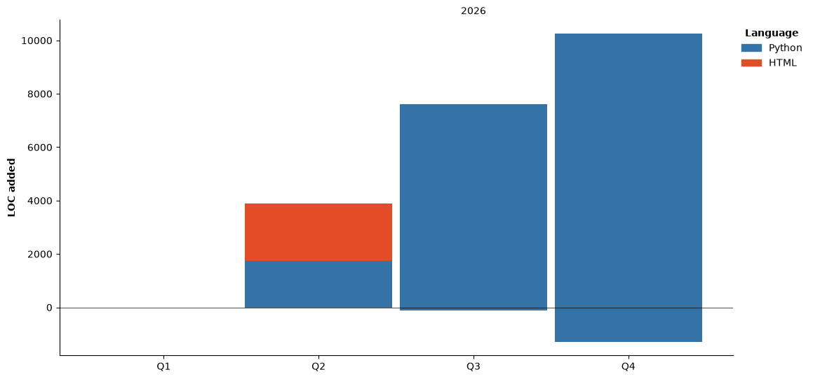

### 🛠 Backend


### 🧰 Tools


<!--START_SECTION:waka-->


**🐱 My GitHub Data** 

> 📦 ? Used in GitHub's Storage 
 > 
> 🏆 58 Contributions in the Year 2026
 > 
> 🚫 Not Opted to Hire
 > 
> 📜 14 Public Repositories 
 > 
> 🔑 0 Private Repositories 
 > 
**I'm an Early 🐤** 

```text
🌞 Morning                14 commits          ███████░░░░░░░░░░░░░░░░░░   26.92 % 
🌆 Daytime                27 commits          █████████████░░░░░░░░░░░░   51.92 % 
🌃 Evening                11 commits          █████░░░░░░░░░░░░░░░░░░░░   21.15 % 
🌙 Night                  0 commits           ░░░░░░░░░░░░░░░░░░░░░░░░░   00.00 % 
```
📅 **I'm Most Productive on Saturday** 

```text
Monday                   3 commits           █░░░░░░░░░░░░░░░░░░░░░░░░   05.77 % 
Tuesday                  6 commits           ███░░░░░░░░░░░░░░░░░░░░░░   11.54 % 
Wednesday                3 commits           █░░░░░░░░░░░░░░░░░░░░░░░░   05.77 % 
Thursday                 14 commits          ███████░░░░░░░░░░░░░░░░░░   26.92 % 
Friday                   4 commits           ██░░░░░░░░░░░░░░░░░░░░░░░   07.69 % 
Saturday                 20 commits          ██████████░░░░░░░░░░░░░░░   38.46 % 
Sunday                   2 commits           █░░░░░░░░░░░░░░░░░░░░░░░░   03.85 % 
```


📊 **This Week I Spent My Time On** 

```text
🕑︎ Time Zone: Europe/Moscow

💬 Programming Languages: 
JavaScript               19 mins             █████████░░░░░░░░░░░░░░░░   35.97 % 
TypeScript               18 mins             ████████░░░░░░░░░░░░░░░░░   33.13 % 
Python                   14 mins             ██████░░░░░░░░░░░░░░░░░░░   25.50 % 
CSS                      2 mins              █░░░░░░░░░░░░░░░░░░░░░░░░   05.27 % 
Git Config               0 secs              ░░░░░░░░░░░░░░░░░░░░░░░░░   00.13 % 

🔥 Editors: 
Opencode Cli             40 mins             ██████████████████░░░░░░░   73.81 % 
VS Code                  14 mins             ███████░░░░░░░░░░░░░░░░░░   26.19 % 

🐱‍💻 Projects: 
screenshot-to-scene-6121-37 mins             █████████████████░░░░░░░░   68.43 % 
api                      14 mins             ██████░░░░░░░░░░░░░░░░░░░   25.63 % 
Unknown Project          3 mins              █░░░░░░░░░░░░░░░░░░░░░░░░   05.94 % 

💻 Operating System: 
Windows                  55 mins             █████████████████████████   100.00 % 
```

🤖 **AI Coding This Week** 

```text
⏱ AI Coding Time: 40 mins (74.37%)

✍️ 269 lines written by AI, 9 lines written by hand (96.76% AI-written)

🔤 215,453 Input Tokens, 77,659 Output Tokens

💵 $27.13 Estimated AI Cost This Week

🧠 1 AI Sessions, 5 AI Prompts

DeepSeek                 295 lines           █████████████████████████   100.00 % 

🔎 AI Coding Insights:
🤖 AI-Driven — 96.76% of written lines came from AI
📝 Concise Prompter — average 74 characters per prompt
🔁 Iterative Prompter — average 5 prompts per session
🚀 High AI Trust — 3.24% of changed lines were hand-edited
```

**I Mostly Code in Python** 

```text
Python                   9 repos             ██████████████░░░░░░░░░░░   56.25 % 
TypeScript               6 repos             █████████░░░░░░░░░░░░░░░░   37.50 % 
HTML                     1 repo              ██░░░░░░░░░░░░░░░░░░░░░░░   06.25 % 
```


**Timeline**




 Last Updated on 24/11/2026 08:54:07 UTC
<!--END_SECTION:waka-->
